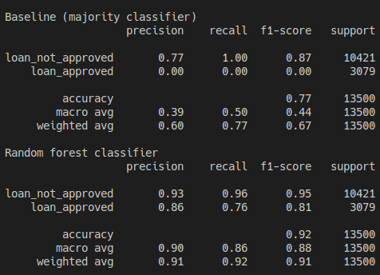

## Docker and databases hands-on exam

Your goal is to solve the following tasks:

### PART 1: Setup the Docker compose stack
Implement the following services with minimal set of parameters in a docker-compose.yml:
- [jupyter](quay.io/jupyter/base-notebook)
    - Image: `quay.io/jupyter/base-notebook`
    - Service name: `jupyter`
    - Set the default password to access the jupyter Web interface to `ulfrids`
    - You can follow the following tutorial to setup the docker-compose: [https://docs.docker.com/guides/jupyter/](https://docs.docker.com/guides/jupyter/). 
    - JupyterLab should be accessible on port `8889` on the host.
    - Use an appropriate mechanism to persist and/or read the data while executing sql.ipynb.
    - The sqlite database does not need to be persisted locally (if you persist it, make sure you do not push it to the git).
- [dbgate](https://hub.docker.com/r/dbgate/dbgate)
    - Image: select an appropriate image for the task
    - Service name: `dbgui`
    - Map dbgate's web interface default container port to port `6836` on the host. The interface should now be accessible at [http://localhost:6836](http://localhost:6836)

#### TODO: add here command(s) for running the docker compose stack in a detached mode:
```bash

```

#### The expected results of this phase are:
- a `docker-compose.yml` file in the root of this repository implementing the stack above.
- the command(s) needed to run the docker compose stack

### PART 2: SQL
Follow the instructions in `sql.ipynb` to implement the solutions. 

The notebook should be implemented and possible to run within the docker-compose stack. The database should now have your data.

#### TODO: add here a screenshot of the UI where tables from dbgate of the provided database can be visible along with the browser URL.


#### The expected results of this phase are:
- implemented everything required in `sql.ipynb` (and saved run version of the notebook)
- saved `applicants_loan_applications.csv` in `predictive/data` folder
- a screenshot of the dbgate's web interface when logged-in, showing the two tables (`loan_applications` and `applicants`)

### PART 3: Predictive modeling
Your goal is to predict if a bank should approve a loan application or not.

Perform binary classification on the dataset `predictive/data/applicants_loan_applications.csv` you saved in the `sql.ipynb` notebook. The feature columns and target column are already specified in `predictive/model.py`.

Start by establishing a predictive baseline: a dummy classifier that always predicts the majority class. Evaluate the dummy classifier against the test data with [sklearn.metrics.classification_report](https://scikit-learn.org/stable/modules/generated/sklearn.metrics.classification_report.html) provided by scikit. Analogously, train a RandomForestClassifier and compare it to the baseline with the same `classification_report()`.

Here's an example output of the classification report for both models:



Now implement `predictive/Dockerfile` that specifes a custom container image (tag it `loanprediction`) based on `python:3.10-slim` that installs needed libraries and runs the `model.py` script from above on the provided data (use an appropriate docker mechanism to use the csv data file from the host).

#### TODO add here commands for building and running the custom docker container
```bash

```

#### The expected results of this phase are:
- implemented `predictive/model.py` that:
    - reads the `predictive/data/applicants_loan_applications.csv` from the previous task
    - splits it into a train and test set with [sklearn.model_selection.train_test_split](https://scikit-learn.org/stable/modules/generated/sklearn.model_selection.train_test_split.html).
    - fits a dummy majority classifier as a predictive baseline ([sklearn.dummy.DummyClassifier](https://scikit-learn.org/stable/modules/generated/sklearn.dummy.DummyClassifier.html) and [sklearn dummy estimators user guide](https://scikit-learn.org/stable/modules/model_evaluation.html#dummy-estimators)).
    - fits a random forest classifier ([sklearn.ensemble.RandomForestClassifier](https://scikit-learn.org/stable/modules/generated/sklearn.ensemble.RandomForestClassifier.html))
    - compares performance of both with [sklearn.metrics.classification_report](https://scikit-learn.org/stable/modules/generated/sklearn.metrics.classification_report.html) on the test set (just print the classification_report() of each classifier).
- implemented `predictive/Dockerfile` that builds a standalone container image to run `model.py`. Tag the image as `loanprediction`
- written commands on how to build the container image from the `Dockerfile` and run it with the `applicants_loan_applications.csv` as the dataset.

### 4. Double-check your work & submit
Go through the instructions again and make sure you implemented everything as requested. Save all the files, include them into git (double check if everything needed is included) and push your work to the remote repository.
